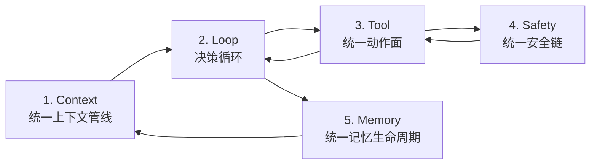

# Sunshinex

<div align="center">

**通用 AI Agent 工程化骨架** —— 云端大模型负责推理，本地负责编排、执行、安全与记忆。

Harness / Loop / Graph 三层嵌套范式，对标 Claude Code / OpenAI Codex / Hermes。

[](docs/PLATFORM.md)
[](docs/PLATFORM.md)
[](CLAUDE.md)
[](#%E4%BA%A7%E5%93%81%E4%BA%AE%E7%82%B9)

</div>

---

## 📸 产品预览

**欢迎页** —— 打开即用：选好工作区、分支与权限档，一句话开始任务。


**对话工作台** —— 长任务实时流式输出，Markdown / 表格 / 代码块完整渲染，改动统计（+1644 −1）一键查看 Diff。


## ✨ 产品亮点

- **三面入口，同一引擎**：交互式 **TUI**（对标 Claude Code，ink + React）+ 桌面/浏览器双形态 **GUI**（对标 Codex 工作台：对话、Diff、任务板、终端、内置浏览器页签）+ CLI 基础执行面，共用同一会话内核，会话数据互通。
- **数据主权在你手里**：任意 OpenAI 协议兼容供应商（BigModel、DeepSeek、OpenRouter、vLLM 本地部署…）负责推理，编排、执行、安全、记忆全部本地完成，密钥与数据不出本机（`~/.sunshinex/`）。
- **长任务稳定可靠**：Reactor 400 步宽预算 + Loop 验收修正环（生成→校验→修正→终止，Impossible 三值裁决）+ 跨天持久化 resume，复杂编码长任务（跨文件重构、测试闭环）可过夜运行、断点续走。
- **多 Agent 编排**：持久任务板（依赖 / 审批门 / 裁决）+ 长驻 teammate + 外部 CLI 执行体 + 定向消息，崩溃可恢复（kill -9 验收）。
- **生产级安全底座**：权限三态（deny→ask→allow）、写面信任域 + 审批流、Linux Landlock 内核围栏、审计回滚——全盘可读、写面受控。
- **开放扩展生态**：MCP 协议兼容（与主流客户端格式互通）、技能五根就近遮蔽（兼容 `.claude` / `.codex` / `.cursor` / `.agents` 既有资产）、子智能体注册制、插件治理层（内置 browser-use / computer-use 双形态样例）。
- **三级持久记忆**：技能 / 项目 / 用户分层沉淀，任务成功自动固化为可复用技能，越用越顺手。
- **一份代码，三平台部署**：Windows / macOS / Linux 全平台安装、构建、自检；CI 双平台 × 双 Node 版本矩阵守护（详见 [docs/PLATFORM.md](docs/PLATFORM.md)）。
- **工程质量可证**：TypeScript strict 零 any，3200+ 自动化测试（主仓 + GUI 真 daemon e2e）+ `selfcheck` 骨架自检，`pnpm test` 一键全量。

## 🏗️ 架构优势

核心是**统一运行时主链**——五个环节按数据流串联成闭环，单一数据流、无旁路：



**为什么是主链，而不是能力拼接？**

- **每条验收可证伪**：上下文只能从 Context 进、动作只能从 Tool 出、执行必经 Safety、记忆只走 Memory——反例即不合格，不靠文档自觉。
- **明星产品能力被拆解到主链环节**：Claude Code 的指令分层/路径规则、Codex 的算力路由/多执行后端、Hermes 的持久记忆/自我验证，均映射到 Context / Loop / Tool / Safety / Memory 对应环节，通过统一接口协同，而非外挂补丁。
- **三层范式各司其职**：Harness 底座（工具面 / 安全链 / 记忆 / 技能 / MCP）承载一切；Loop 负责自主迭代（生成→校验→修正）；Graph 负责多角色 DAG 协作编排，节点可嵌入 Loop 子流程。
- **三面入口共用一个装配根**：CLI / TUI / GUI 只消费同一 SessionEvents 事件面与审批契约，新能力三面同步获得，无重复实现漂移。

分层依赖：`graph → loop → harness → model / storage`。文件级结构详见 [CLAUDE.md](CLAUDE.md)。

```text
src/
  cli/       # CLI 执行面（selfcheck / run / pipeline / serve / skills install / kb-index / plugins / agents / providers / mcp / settings；裸命令进交互终端）
  tui/       # 交互式终端（ink + React，对标 Claude Code，v1.0 默认入口）
  session/   # 会话内核（SessionKernel：转录/等待队列唯一投影 + v3 段级会话档读写）与 KernelRuntime 装配单点（CLI/TUI/GUI 共用）
  harness/   # 运行时底座：闭环引擎、工具面与内置工具、安全链、上下文、记忆、技能、MCP、子智能体、知识库
  loop/      # Loop 引擎（生成→校验→修正）
  graph/     # DAG 多角色协作编排
  model/     # 模型适配 + 三档算力路由
  taskboard/ delegation/   # 任务板与委派投影域模型（TUI/GUI 同源）
  serve/     # GUI daemon（HTTP + WebSocket 服务、PTY 中继、配置面）
  catalog/   # 设置存储结构化单点（providers/agents/plugins/mcp/skills/permissions 的读写面，CLI/TUI/serve 共用）
  config/ storage/   # 配置装载、存储底座
gui/         # 浏览器 GUI 前端（React 18 + Vite 工作区包，构建产物 dist-gui/）
shell/       # Electron 桌面壳工作区包（托盘驻留、全局快捷键、安装包打包）
plugins/     # 插件工作区根（内置插件 manifest + 技能；用户级 ~/.sunshinex/plugins/；开发指南 docs/PLUGIN-DEV.md）
```

## 📦 安装

### 方式一：GUI 桌面安装包（最简单）

到 [GitHub Releases](https://github.com/searchforsun/sunshinex/releases) 下载对应系统与处理器的安装包（如 Windows x64 选 `sunshinex-<版本>-win-x64-setup.exe`），双击安装（可选安装目录，无需管理员），开始菜单启动。关闭窗口最小化到托盘，`Alt+Shift+S` 随时唤起。

### 方式二：npm 全局安装（TUI/CLI，三选一）

```bash
# ① GitHub Release 链接直装（推荐，无需 npm 账号）
npm install -g https://github.com/searchforsun/sunshinex/releases/download/v0.6.0/sunshinex-agent-0.6.0.tgz

# ② npm registry（正式发布后可用）
npm install -g sunshinex-agent

# ③ 本地打包安装
npm pack && npm install -g ./sunshinex-agent-0.6.0.tgz
```

> npm ≥ 12 走 ① 报 `EALLOWREMOTE`（`allow-remote` 缺省禁止从 URL 取包）：加 `--allow-remote=all`，或先 `curl -LO` 下载 tarball 再按 ③ 本地安装（不受该限制）。

### 方式三：源码运行（开发者）

```bash
git clone https://github.com/searchforsun/sunshinex.git && cd sunshinex
corepack enable                # 启用 Node 自带 corepack（pnpm 版本由 package.json 钉定）
pnpm install                   # .npmrc 已把 store 固定到仓内，依赖安装不依赖外部缓存目录
pnpm cli                       # 构建并启动交互式终端（缺省 acceptEdits 权限模式）
```

部署条件：Node.js ≥ 22.9 + pnpm（corepack 自动对齐）；GUI 面依赖 `node-pty` 原生模块（安装期编译）。平台差异与部署清单详见 [docs/PLATFORM.md](docs/PLATFORM.md)。

## 🚀 快速开始

模型配置写进 `~/.sunshinex/settings.json`（providers 列表=模型配置唯一事实源，`env` 块放密钥；任意 OpenAI 协议兼容供应商均可）：

```json
{
  "version": 1,
  "providers": [
    {
      "name": "<供应商名>",
      "baseUrl": "https://<端点>/v1",
      "models": [{ "model": "<模型名>" }]
    }
  ],
  "env": { "SUNSHINEX_API_KEY": "sk-…" }
}
```

providers 也可经 CLI 结构化管理：`sunshinex providers add/set/key/test`（见 [MANUAL](MANUAL.md) 命令总表）。

配置优先级：已导出环境变量 > 项目级 `.sunshinex/settings.json` > 全局级 `~/.sunshinex/settings.json` > 内置缺省。全部配置项见 [MANUAL](MANUAL.md)。

> **端点要求**：工具调用恒走原生 function calling（`tools` 字段下发），要求所配端点支持 function calling——模型不支持就换模型，产品侧无文本协议回退。探针实测：open.bigmodel.cn · glm-5.3-flash 于 2026-09-20 五项全过（tools 下发 / 并行 tool_calls / role:tool 回喂 / usage 三字段 / 前缀缓存）。图片附件（GUI 粘贴/+ 面板、TUI Ctrl+V）走 OpenAI vision 形态 `image_url` 内容块下发，仅对纯文本模型在 settings `providers` 显式 `"supportsImages": false` 关闭拦截。

常用入口：

```bash
sunshinex                      # 当前工作区进终端（需全局安装，见上节）
sunshinex ../my-project        # 指定项目目录启动（路径形态位置参数；或 --workdir=../my-project）
sunshinex --mode=read-only|acceptEdits|full-access   # 权限模式（TUI 内 /plan <目标> 进计划流程）
sunshinex --language=zh        # 界面语言（缺省 en；提示词恒英文单语不受影响）
sunshinex <目录> --worktree[=<name>]  # 在隔离 git worktree 内启动（裸旗标自动命名；干净树随会话自动清理，脏树保留待处置）
                               # 会话内亦可经 worktree 工具 create/exit/list 管理隔离树；子智能体经 agent.md `isolation: worktree` 声明获得独立树
pnpm test && pnpm selfcheck    # 全量单测 / 骨架自检
```

### 长任务终止参数

- `maxSteps`（缺省 400）：Reactor 单 run 步数上限
- `maxLoopIterations`（缺省 200）：Loop 修正环节点执行步上限
- `maxGraphNodes`（缺省 1000）：Graph 全链路节点步累计上限

思考强度（reasoning effort）：`settings.json` 语义键 `reasoningEffort`（none|minimal|low|medium|high|xhigh|max，缺省不下发即用端点默认），或启动参数 `--effort=<档>`、会话内 `/model-effort` 选择卡切换；端点不支持该参数时按阶梯逐档降级、全不支持自动省略。

## 🧩 扩展生态

- **技能**：标准形态 `{根}/skills/{id}/SKILL.md`，同名就近遮蔽——项目级五根 `.sunshinex/skills/` > `.agents/skills/` > `.claude/skills/` > `.codex/skills/` > `.cursor/skills/`（只装载标准形态 `{id}/SKILL.md`）> 全局级 `~/.sunshinex/skills/` > 学习级（任务成功自动沉淀，FIFO 上限）。技能清单随会话注入，模型经内置 `skill` 工具按需加载全文。
- **子智能体**：agent.md 目录注册制（两级=项目级 `.sunshinex/agents/{id}/agent.md` 就近遮蔽全局 `~/.sunshinex/agents/`，旧位 `<root>/agents/` 首次装载自动迁入新家；`enabled: false` 停用）（frontmatter 可声明 `isolation: worktree` 隔离、`executor: internal-team` 长驻 teammate / `external-cli` 外部执行体）。
- **MCP**：第三方工具登记于项目级 `.sunshinex/mcp.json` 与全局级 `~/.sunshinex/mcp.json`（`mcpServers` 键，与主流 MCP 客户端格式兼容；项目级同名条目遮蔽全局，与技能装载链同构；登记表为空 = MCP 工具全禁）。
- **插件**：把进程外 MCP server 与技能包成可开关的治理单元——manifest 声明贡献面、缺省开关与工具审批分级（`safety` 三类）；内置 browser-use / computer-use 双形态样例，用户级 `~/.sunshinex/plugins/` 同 id 遮蔽内置；`sunshinex plugins list` / `plugins validate` 自查，开发指南 [docs/PLUGIN-DEV.md](docs/PLUGIN-DEV.md)。
- **问询交互**：模型可经内置 `ask_question` 工具主动向你发起选择题（单选 / 多选 / 「Other…」自由输入），TUI 呈现选择器卡，`↑`/`↓` + `Enter` 作答，`Esc` 跳过。

## 产品形态（v1.0 个人开发者版）

> 目标形态以 [docs/GOAL.md](docs/GOAL.md) 为单一权威，本节为概览。

- **三面入口（均已交付）**：CLI 基础执行面 + 交互式 TUI（对标 Claude Code，ink + React 构建，v1.0 默认入口）+ GUI 桌面端/浏览器双形态（对标 Codex 工作台，Electron 壳 + React 前端）。TUI 内 `/goal <目标>` 触发标准验收修正环，目标支持自然语言条件。
- **云本地分工**：任意 OpenAI 协议兼容供应商（`settings.json` 配置）负责推理，本地负责编排、执行、安全、记忆，数据可控。
- **三层能力全落地**：Harness 底座 + Loop 自主迭代（生成→校验→修正→终止）+ Graph 多角色协作编排。
- **生产级特性**：分级沙箱、三级持久记忆（技能/项目/用户）、MCP 协议兼容、审计回滚、子智能体并行派发；**多 Agent 编排**——持久任务板（依赖/审批门/裁决）+ 长驻 teammate + 外部 CLI 执行体（claude code）+ 定向消息，崩溃可恢复（kill -9 验收）。

## 发版（维护者）

```bash
scripts/release.mjs                            # 按 package.json 当前版本发版
scripts/release.mjs --bump patch|minor|major   # 递增版本号，随发版提交推送
scripts/release.mjs --version 0.6.0            # 指定版本发版（写回 package.json）
scripts/release.mjs --dry-run                  # 只验证 + 打包预览，不触网不落库
scripts/release.mjs --version 0.6.0 --clobber  # 同版本重发（覆盖附件，须显式授权）
scripts/release.mjs --no-gui                   # 只发 TUI tgz（跳过 GUI 安装包构建上传）

一次发版 = 同一 Release 同一 tag 上传两类安装包：TUI tgz（sunshinex-agent-<ver>.tgz）+ GUI 安装包（按系统/架构各一个，如 sunshinex-<ver>-win-x64-setup.exe；命名=名称-版本-系统-架构，单点 scripts/release-artifacts.mjs；版本随根 package.json 单源同步；验证链含 GUI/e2e/壳冒烟与安装包静默装冒烟；本机网络受限带双镜像 env，见 MANUAL-GUI 开发者节）
```

- 版本语义：默认不覆盖、不递增，每个版本一个新 tag + 新安装链接，旧链接永久可回溯。
- 前置：工作区干净且已推送；上传 Release 需仓库写权限凭据（classic PAT 勾 `repo`，fine-grained 勾 Contents: Read and write）。
- 上传通道按序探测：`gh` CLI → `GITHUB_TOKEN` → git 凭据助手已存凭据（REST API 上传附件）；缺通道或权限不足在开头预检即报错。
- PAT 交给凭据助手（push 与发版共用）：`printf "protocol=https\nhost=github.com\nusername=<用户名>\npassword=<PAT>\n\n" | git credential approve`；换令牌前先 `git credential reject` 清旧。

## 文档导航

| 文档 | 内容 |
|------|------|
| `docs/GOAL.md` | 目标形态定稿（定位 / 北极星 / 可靠性口径 / 非目标，单一权威） |
| `docs/Arch-Plan.md` | 架构设计方案与分阶段规划 |
| `docs/PLATFORM.md` | 平台兼容性与部署条件（三平台矩阵、部署清单） |
| `docs/ROADMAP.md` | 开发路线图 |
| `docs/PLUGIN-DEV.md` | 插件开发指南（manifest 规范、两级装载、safety 审批三类、plugins CLI 与设置页面） |
| `docs/superpowers/specs/` | 设计 spec 归档 |
| `MANUAL.md` | 使用手册（CLI + TUI：命令、快捷键、权限模式、配置全表） |
| `MANUAL-GUI.md` | GUI 使用手册（桌面壳/浏览器：安装包、界面、标签工作区、设置页、快捷键、FAQ） |
| `CLAUDE.md` | AI 协作规范（完整目录结构 / 编码规范 / 架构约定） |
| `SUNSHINE.md` | 项目业务配置；另有全局约定 `~/.sunshinex/SUNSHINE.md`（对标 `~/.claude/CLAUDE.md`，`SUNSHINEX_GLOBAL_SUNSHINE` 覆盖所在目录） |
| `.sunshinex/mcp.json` | 项目级 MCP 服务器登记（撞名遮蔽全局级 `~/.sunshinex/mcp.json`） |
