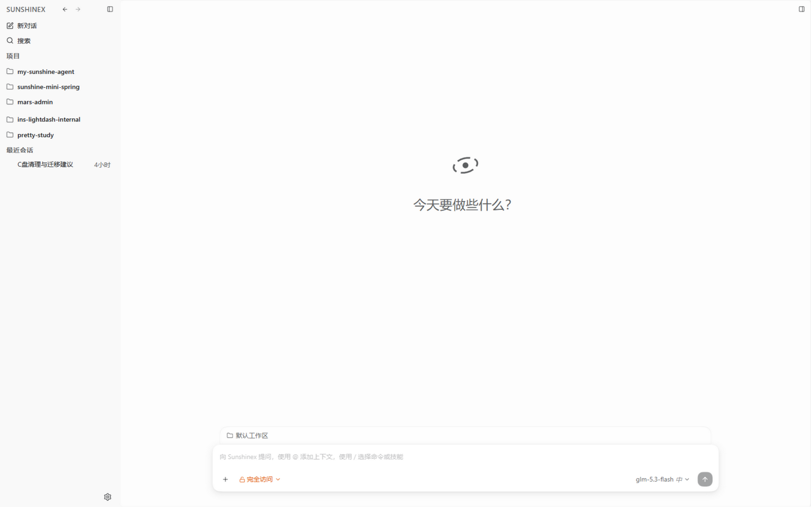
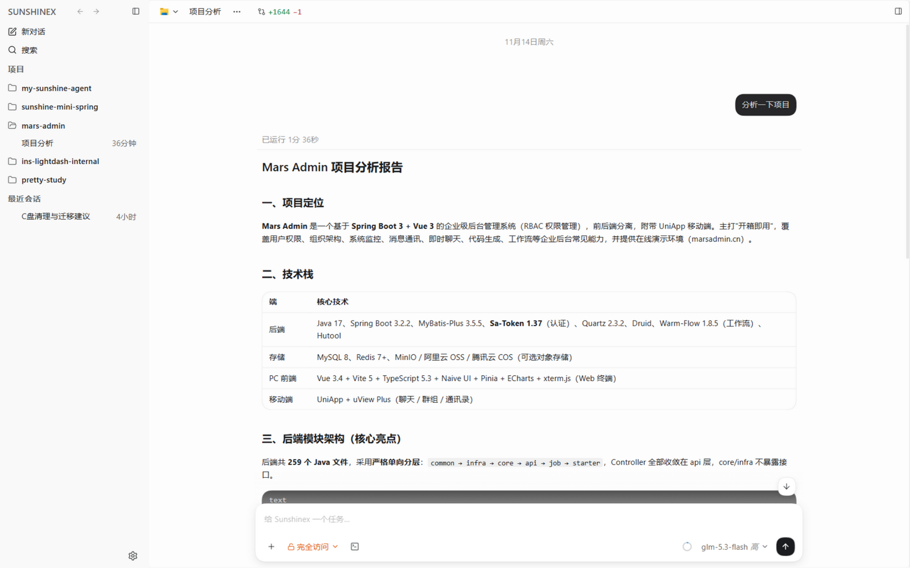
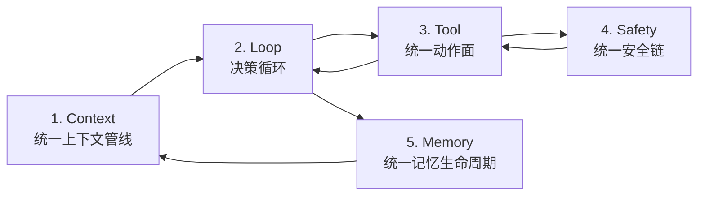

<div align="center">

# Sunshinex

**个人开发者的本机通用 AI Agent**

云端大模型负责推理 · 本地负责编排、执行、安全与记忆

以复杂编码长任务为核心场景，TUI / GUI 双交互面，对标 Claude Code / OpenAI Codex

[](docs/PLATFORM.md)
[](docs/PLATFORM.md)
[](CLAUDE.md)
[](CLAUDE.md)

</div>

---

## 产品预览

<p align="center">
  
</p>
<p align="center"><b>欢迎页</b> — 选好工作区、分支与权限档，一句话开始任务</p>

<p align="center">
  
</p>
<p align="center"><b>对话工作台</b> — 长任务流式输出，Markdown / 表格 / 代码块完整渲染，改动一键查看 Diff</p>

## 产品功能

- **三面入口，同一引擎**：CLI 基础执行面、交互式 TUI（对标 Claude Code，35 个斜杠命令）、GUI 桌面端/浏览器（对标 Codex 工作台），共用同一会话内核，会话数据互通。
- **GUI 工作台**：13 类页签——对话、Git 审查（暂存/提交/推送/分支切换）、本轮改动与一键撤销、智能体团队与任务 DAG、子智能体转录、终端（PTY）、内置浏览器（元素拾取）、记忆、学习技能、文件预览等；左栏 VSCode 式目录树 + 全层级搜索。
- **长任务稳定可靠**：验收修正环 + 运行中消息排队（可编辑/重排/插队）+ 跨天 resume、rewind 回退、fork 分叉。
- **多 Agent 编排**：任务板五态 + 依赖 + 审批门 + 裁决；长驻 teammate、外部 CLI 执行体（如 claude code）、定向消息收件箱，kill -9 崩溃可恢复。
- **生产级安全**：权限三档（read-only / acceptEdits / full-access）、审批三态（allow / deny / always）、破坏性命令底线拦截、Linux 下 Landlock 内核围栏。
- **记忆与知识库**：全局 / 项目 / 会话三级记忆注入，任务成功自动沉淀学习级技能，知识库索引 + 向量检索（kb_search）。
- **模型面**：任意 OpenAI 协议兼容供应商，small / medium / large 三档算力路由，思考强度七档自动降级，图片输入三面通用。
- **上下文工程**：checksum 门禁的确定性上下文压缩，超长会话不失真。
- **开放扩展**：MCP 协议兼容（热载）、技能多根就近遮蔽（兼容 `.claude` / `.codex` / `.cursor` / `.agents` 既有资产）、插件治理（内置 browser-use / computer-use 样例）。
- **一份代码，三平台**：Windows / macOS / Linux 全平台支持，3200+ 自动化测试 + `selfcheck` 全链路自检守护。

## 架构

核心是**统一运行时主链**——五个环节按数据流串联成闭环，单一数据流、无旁路，每条设计验收可证伪：



分层依赖：`graph → loop → harness → model / storage`；CLI / TUI / GUI 三面共用同一装配根，新能力三面同步获得。文件级结构详见 [CLAUDE.md](CLAUDE.md)。

## 安装

**GUI 桌面端**：到 [GitHub Releases](https://github.com/searchforsun/sunshinex/releases) 下载安装包（如 Windows x64 选 `sunshinex-<版本>-win-x64-setup.exe`），双击安装即可。

**TUI / CLI**（npm 全局安装，三选一）：

```bash
# ① GitHub Release 直装（推荐）
npm install -g https://github.com/searchforsun/sunshinex/releases/download/v0.6.0/sunshinex-agent-0.6.0.tgz

# ② npm registry
npm install -g sunshinex-agent

# ③ 本地打包安装
npm pack && npm install -g ./sunshinex-agent-0.6.0.tgz
```

**源码运行**（开发者）：

```bash
git clone https://github.com/searchforsun/sunshinex.git && cd sunshinex
corepack enable && pnpm install
pnpm cli                       # 构建并启动交互式终端
```

## 快速开始

模型配置写进 `~/.sunshinex/settings.json`（任意 OpenAI 协议兼容供应商均可）：

```json
{
  "version": 1,
  "providers": [
    {
      "name": "<供应商名>",
      "baseUrl": "https://<端点>/v1",
      "models": [{ "model": "<模型名>" }]
    }
  ],
  "env": { "SUNSHINEX_API_KEY": "sk-…" }
}
```

```bash
sunshinex                # 当前工作区进终端
sunshinex ../my-project  # 指定项目目录启动
sunshinex --mode=acceptEdits   # 权限模式（read-only / acceptEdits / full-access）
```

更多配置项、命令与快捷键见 [MANUAL](MANUAL.md)（CLI + TUI）与 [MANUAL-GUI](MANUAL-GUI.md)（桌面端/浏览器）。

## 文档导航

| 文档 | 内容 |
|------|------|
| `docs/GOAL.md` | 目标形态定稿（定位 / 北极星 / 非目标） |
| `docs/Arch-Plan.md` | 架构设计方案与分阶段规划 |
| `docs/PLATFORM.md` | 平台兼容性与部署条件（三平台矩阵） |
| `docs/ROADMAP.md` | 开发路线图 |
| `docs/PLUGIN-DEV.md` | 插件开发指南 |
| `MANUAL.md` | 使用手册（CLI + TUI：命令、快捷键、权限模式、配置全表） |
| `MANUAL-GUI.md` | GUI 使用手册（桌面壳/浏览器） |
| `CLAUDE.md` | AI 协作规范（完整目录结构 / 编码规范 / 架构约定） |
